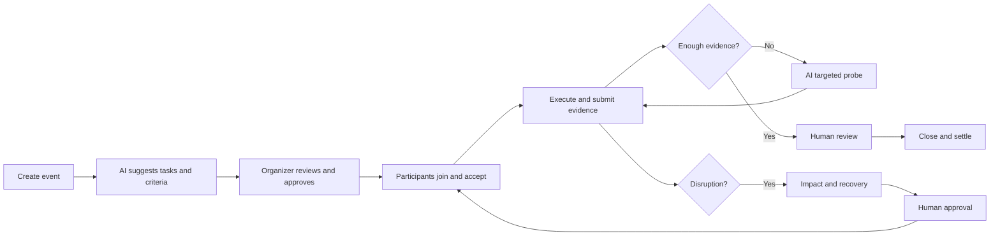
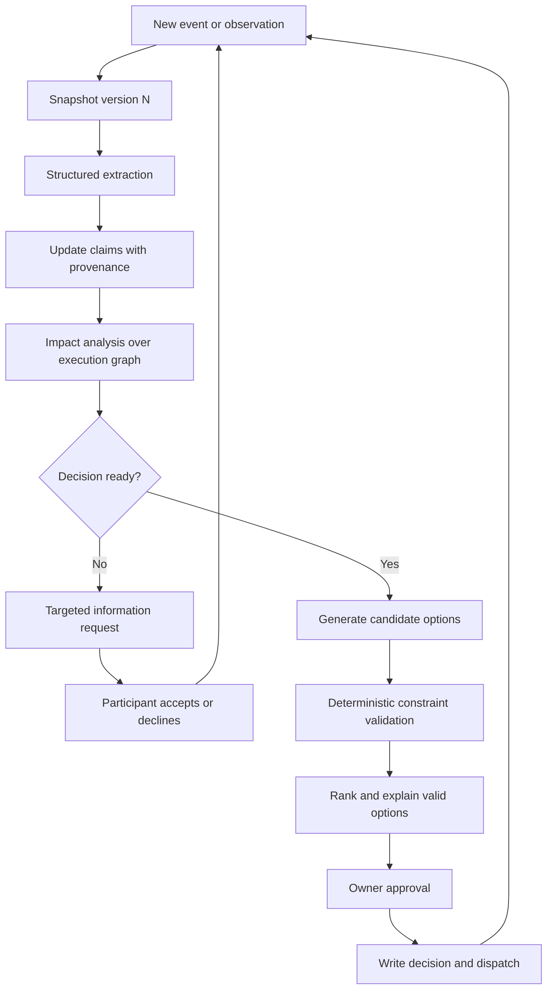
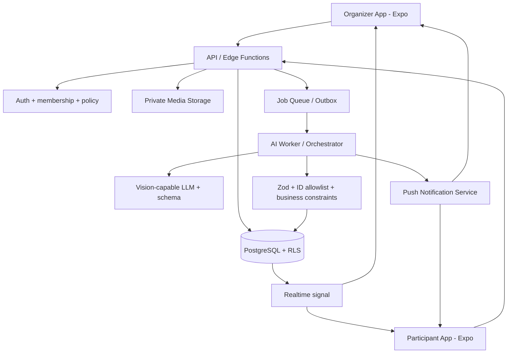
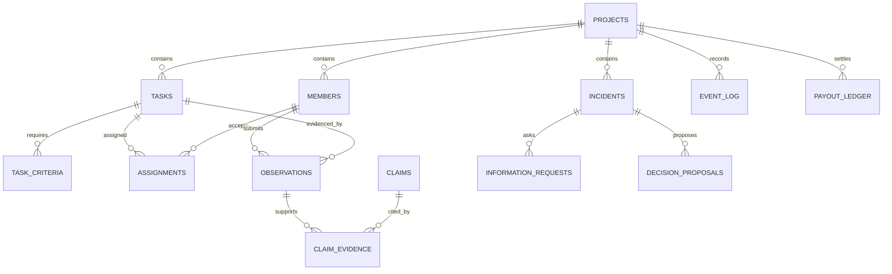

# WEAVE 4.0 — Comprehensive Product & Technical Design

> **Adaptive Event Operations**  
> **Tagline:** *From plan to proof. From disruption to recovery.*  
> **Phiên bản:** 4.0 — Design Baseline  
> **Ngày biên soạn:** 13/11/2026  
> **Chu kỳ phát triển dự kiến:** 4 tuần, 14/11–11/12/2026  
> **Trạng thái:** **ĐỀ XUẤT THIẾT KẾ**; chưa phải bản xác nhận đã triển khai, đã có người dùng hay có số đo thực nghiệm.  
> **Đối tượng đọc:** Product Owner, Mobile Engineer, Backend Engineer, AI Engineer, QA, người phụ trách thử nghiệm và giám khảo.

---

## 0. Hướng dẫn sử dụng tài liệu

### 0.1. Phân biệt bằng chứng, quyết định và giả thuyết

Để tránh nhầm *kế hoạch* với *thành tích*, tài liệu sử dụng 4 nhãn:

| Nhãn | Ý nghĩa | Ví dụ |
|---|---|---|
| **DESIGN DECISION** | Phương án kiến trúc/sản phẩm được chọn cho baseline | Một backend có state authoritative; AI không tự duyệt việc |
| **P0 / P1 / P2** | Phạm vi và ưu tiên triển khai | P0: active probing; P1: counterfactual preview nâng cao |
| **HYPOTHESIS** | Giả thuyết phải kiểm chứng | Organizer sẵn lòng trả tiền để giảm công điều phối |
| **TARGET** | Ngưỡng team tự đặt, không phải kết quả | Recovery proposal hợp lệ ≥90% trong bộ eval |

**Không có số liệu vận hành, kết quả phỏng vấn, khách hàng trả phí hay kết quả pilot nào được xác nhận trong các tài liệu nguồn hiện có.** Phần “100/100” là đích theo rubric khi đủ bằng chứng, không phải điểm đã đạt.

### 0.2. Nguồn thiết kế và phạm vi phát triển

- `WEAVE_2.0_Detailed_Specification.docx`: Active Collective Intelligence Loop (ACIL), shared evidence state, active probing, human approval, kiến trúc Expo/Supabase, nghiệm thu, privacy.
- `WEAVE_Ke_hoach_tong_the.md` (bản Claude): workflow kế hoạch → công việc → bàn giao → duyệt → đối soát trợ cấp; organizer/participant; bộ đánh giá AI; pilot thực địa; mô hình tăng trưởng.
- Brainstorming WEAVE 3.0/3.1/4.0 trong cuộc hội thoại: Adaptive Decision Engine, Execution Graph + Evidence Graph, Decision Readiness Gate, Counterfactual Preview, AI ablation và lịch 4 tuần.
- Những mở rộng kỹ thuật trong tài liệu này, như event outbox, schema/API, policy và contract, là **đề xuất triển khai mới**, cần team review và điều chỉnh theo stack thực tế.

### 0.3. Những gì phải có sau 4 tuần

**Định nghĩa Pilot-ready MVP:** Người tổ chức có thể tạo sự kiện, AI hỗ trợ lập kế hoạch, người tham gia nhận việc qua mã mời, gửi bằng chứng, chủ trì kiểm duyệt, hệ thống nhận biết sự cố và chủ động hỏi thêm dữ kiện, đưa phương án recovery có giải thích, có approval, cuối sự kiện xuất báo cáo/bảng đối soát; dữ liệu được bảo vệ, có test, chạy trên điện thoại thật và có pilot/research evidence ở mức thực tế thu được.

**Không đồng nghĩa:** Enterprise-ready; AI chính xác tuyệt đối; thanh toán tự động; product–market fit; đã đo giảm 50% công điều phối; có thị trường toàn cầu.

---

# PHẦN I — SẢN PHẨM, NGƯỜI DÙNG & PHẠM VI

## 1. Executive summary

**WEAVE 4.0** là công cụ điều hành sự kiện cho nhóm ngắn hạn làm việc tại hiện trường, nơi mỗi người chỉ biết một phần sự thật. WEAVE liên kết **kế hoạch**, **trạng thái thực thi**, **bằng chứng quan sát**, **tình huống bất thường** và **quyết định đã phê duyệt** trên cùng một hệ thống mobile.

Ba tầng trải nghiệm:

1. **WEAVE PLAN — Before:** Từ mô tả/ảnh kế hoạch đến các task có tiêu chí, dependency, deadline, vai trò, chi phí trợ cấp dự kiến; chủ trì duyệt.
2. **WEAVE LIVE — During:** Nhận tiến độ và bằng chứng, phát hiện gap/conflict/risk; AI hỏi đúng người khi dữ liệu thiếu và đề xuất điều phối lại khi kế hoạch vỡ; con người duyệt.
3. **WEAVE CLOSE — After:** Tổng kết thực thi, audit trail, bảng đối soát trợ cấp; không giữ tiền và không tự chuyển tiền.

**Mấu chốt khác biệt không phải “AI tạo task” mà là:**

> *Một thay đổi tại hiện trường làm dữ kiện cũ mất hiệu lực → WEAVE phát hiện ảnh hưởng → hỏi đúng người phần thông tin thiếu → đề xuất phương án mới hợp lệ có bằng chứng và trade-off → chủ trì quyết định.*

## 2. Problem statement và JTBD

### 2.1. Vấn đề mục tiêu

Các đội vận hành sự kiện nhỏ/vừa thường phối hợp qua nhóm chat, bảng tính và gọi điện. Khi người vắng mặt, thiết bị hỏng, task trễ hoặc bàn giao không đạt, thông tin phân tán khiến người điều phối phải tự tổng hợp, xác minh, đổi người, đổi thứ tự công việc và cập nhật lại cả nhóm.

**Đây là giả thuyết vấn đề**, cần kiểm chứng qua câu chuyện thực tế từ organizer và pilot. Không suy ra nhu cầu trả phí chỉ vì demo hấp dẫn.

### 2.2. Job-to-be-done

> Khi tôi điều phối một sự kiện có nhiều người ở nhiều khu vực, tôi muốn biết việc gì đã hoàn thành có căn cứ, điều gì còn chưa chắc chắn, kế hoạch nào đang bị đe dọa và nên đổi phương án như thế nào — để cả nhóm xử lý biến cố nhanh mà không phụ thuộc hoàn toàn vào một người điều phối.

### 2.3. Persona và quyền lợi

| Persona | Công việc | Việc họ cần | Lo ngại chính |
|---|---|---|---|
| **Organizer / Owner** | Thiết lập sự kiện, phân công, duyệt & giải quyết sự cố | Toàn cảnh, attention queue, bằng chứng, phương án recovery | AI quyết sai, mất kiểm soát, UI rối |
| **Participant / Volunteer** | Nhận việc, báo tiến độ, bàn giao, trả lời AI | Một task rõ ràng, ít chạm, quyền từ chối | Bị giao sai, bị chấm oan, lộ dữ liệu |
| **Area Lead** *(P1)* | Phụ trách một khu vực/nhóm | Trạng thái khu vực, escalation, xác minh | Quá nhiều thông báo |
| **Reviewer** *(P1)* | Kiểm tra báo cáo/bảng chi | Chứng từ truy vết và lịch sử duyệt | Bằng chứng không xác thực |

**Buyer hypothesis:** Người có ngân sách có thể là trưởng ban tổ chức hoặc công ty tổ chức sự kiện thường xuyên; không mặc định participant hoặc CLB sẽ trả tiền.

### 2.4. Segmentation và beachhead

- **Pilot thuận tiện:** CLB sinh viên, hackathon, sự kiện cộng đồng, chương trình tình nguyện có khoảng 8–30 người vận hành.
- **Buyer cần kiểm chứng:** Agency tổ chức sự kiện vừa/nhỏ, venue operators, đội điều phối sự kiện có tần suất hoạt động đều đặn.
- **Không nhắm tới tháng đầu:** Enterprise events nhiều nghìn người, điều phối an toàn công cộng, cứu hộ, y tế, hạ tầng trọng yếu.

## 3. Value proposition và positioning

**Một câu cho người dùng:** “WEAVE giúp ban tổ chức biết việc nào xong thật, xử lý nhanh khi kế hoạch thay đổi và đối soát công việc bằng bằng chứng.”

**Một câu tiếng Anh:** *WEAVE helps event teams verify what's done, recover when plans break, and close out work with evidence.*

| Thay thế một phần | WEAVE cung cấp thêm gì (giả thuyết cần chứng minh) |
|---|---|
| Chat nhóm | State có cấu trúc + câu hỏi có người nhận + log quyết định |
| Bảng tính task | Evidence theo tiêu chí + trạng thái unknown/conflicted |
| AI planner tĩnh | Nhận thay đổi, đánh giá lại tác động và đề xuất recovery |
| Task manager thông thường | Active information gathering tại hiện trường và decision contract có nguồn |

**Không tuyên bố** “đầu tiên”, “duy nhất”, “đối thủ không thể làm”, “AI luôn đúng”. Tính khác biệt phải được kiểm chứng trên bài toán thực tế.

## 4. Phạm vi MVP theo mức ưu tiên

| Module / chức năng | Mức | Cam kết 4 tuần / điều kiện |
|---|---|---|
| Native Android/iOS, reopen app và session restoration | **P0** | Cold restart giữ đúng project và membership |
| Create event, invite bằng mã/QR, join & consent | **P0** | Owner duyệt membership trước khi xem dữ liệu riêng |
| AI tạo task từ mô tả text theo schema | **P0** | Owner phải duyệt trước khi xuất bản |
| Task tiêu chí, deadline, role, dependency cơ bản | **P0** | Cấu trúc tường minh, kiểm tra cycle |
| Phân công & accept/decline | **P0** | Assignment có transaction guard |
| Bàn giao text + ảnh, nguồn và thời điểm | **P0** | Media private, retry, liên kết observation |
| AI evidence assistance + human approval | **P0** | Không tự tuyên bố VERIFIED chỉ vì model tự tin |
| Shared state: supported/unknown/conflicted | **P0** | Evidence references đi cùng kết luận |
| Active Probe đúng người | **P0** | Participant có `respond`, `cannot_check`, `decline` |
| Impact Analysis + Recovery Proposal | **P0** | Code validate constraints; owner approve |
| Decision/event log + version guard | **P0** | Append-only; chống stale updates |
| Push notification + refetch reconnect | **P0** | Test với development build thật |
| Organizer attention queue và participant feed | **P0** | Không hiển thị dependency graph phức tạp cho participant |
| Báo cáo + bảng đối soát / CSV | **P0-lite** | Không kết nối cổng thanh toán |
| AI hiểu ảnh kế hoạch phức tạp/OCR sâu | **P1** | Chỉ bật khi text baseline đạt |
| Counterfactual Preview nâng cao | **P1** | Có so sánh 2 phương án, không bịa ETA/cost |
| Offline submission queue | **P1** | Có idempotency; nếu chưa xong thì thông báo offline rõ |
| Cross-event memory | **P2** | Chỉ từ dữ liệu pilot có đồng ý |
| Voice, đa ngôn ngữ, workspace đa tổ chức | **P2** | Sau tháng đầu |
| Ví tiền, autonomous payments, live GPS, AR, 3D | **OUT** | Không xây cho MVP |

### 4.1. Quy tắc cắt scope

Nếu timeline căng, cắt tuần tự: **OCR nâng cao → Counterfactual Preview P1 → offline queue P1 → tính năng báo cáo đẹp → hỗ trợ role phức tạp**. Không cắt: native app thật, observation–gap–probe–recovery–approval có evidence, phân quyền, sự kiện có thể chạy lại không hardcode.

### 4.2. Tiêu chí Done của MVP

- 3 điện thoại thật (ít nhất 1 organizer + 2 participant) tham gia cùng project.
- Chủ trì đóng hẳn và mở lại app, project/decision state khôi phục đúng.
- Một thay đổi mới từ participant tạo ra phân tích AI mới, không phải text hardcode theo ID demo.
- AI hỏi một thông tin chưa biết tới đúng participant; reply cập nhật shared state.
- Khi sự kiện bất ngờ làm phương án cũ không phù hợp, hệ thống không tiếp tục đề xuất phương án đã stale.
- Mỗi action proposal có nguồn và người phê duyệt; không chuyển tiền hoặc điều khiển hành động vật lý tự động.
- Có một đường đi fallback khi LLM timeout, người dùng từ chối hoặc mất kết nối.
- Có log đánh giá và kịch bản đo so sánh với baseline thủ công.

---

# PHẦN II — USER JOURNEYS & UX MOBILE

## 5. Luồng tổng thể



## 6. Organizer journey

| Bước | Màn hình | Hành động | Điều kiện thành công |
|---|---|---|---|
| O1 | Create Event | Nhập mục tiêu, loại sự kiện, deadline, team size | Event tạo với trạng thái `draft` |
| O2 | AI Plan Review | Xem task, sửa tiêu chí, dependency, role | Task chỉ publish sau approve |
| O3 | Invite & Members | Tạo QR/code, duyệt yêu cầu join | Thành viên chỉ đọc event đã approved |
| O4 | Command Center | Xem blocked/at-risk/awaiting approval | Không bỏ sót việc cần người xử lý |
| O5 | Evidence Review | Xem ảnh và từng criterion | Approve/reject/request clarification được log |
| O6 | Recovery Review | Xem trigger, affected tasks, missing facts, options | Có thể approve/reject/defer |
| O7 | Close | Xem tổng kết, xuất CSV/bảng trợ cấp | Số tiền từ task được duyệt, không tự thanh toán |

## 7. Participant journey

1. Mở app → nhập mã hoặc scan QR → xem consent & phạm vi dữ liệu.
2. Chọn nickname, role và availability (khung giờ/ràng buộc do chính họ khai báo).
3. Chờ organizer duyệt vào event nếu policy yêu cầu.
4. Nhận task → xem mục tiêu, criteria, hạn chót, trợ cấp dự kiến (nếu có) → Accept/Decline.
5. Khi làm xong, chụp ảnh và/hoặc gửi ghi chú → xem preview → Submit.
6. Nếu AI yêu cầu quan sát cụ thể: trả lời, `cannot_check` hoặc `decline`.
7. Xem trạng thái `submitted`, `needs_clarification`, `awaiting_review`, `approved` hoặc `rejected` và lý do.
8. Không tự thay đổi approved_by, AI claim status hoặc payout.

**UX rule:** Participant hoàn thành hành động thường gặp trong khoảng vài thao tác; mục tiêu dưới một phút là TARGET để đo usability, không phải tính năng đã xác nhận.

## 8. Information architecture — màn hình

| Screen | Vai trò | Thành phần quan trọng | P |
|---|---|---|---|
| Onboarding / Join | All | Code/QR, privacy, nickname, trạng thái join | P0 |
| Create Event | Owner | Objective, success criteria, date, constraints | P0 |
| AI Plan Review | Owner | Suggested tasks, criteria, dependency, edit/approve | P0 |
| Command Center | Owner | Attention Queue, project status, incidents | P0 |
| My Tasks | Participant | Current/next task, accept/decline | P0 |
| Submit Evidence | Participant | Text, camera preview, retry | P0 |
| AI Probe Inbox | Participant | Question, why me, respond/cannot/decline | P0 |
| Decision Review | Owner | Trigger, evidence, unknowns, options, approval | P0 |
| Evidence Detail | Owner/Member | Source, capture time, status, related claim | P0 |
| Close & Settlement | Owner | Approved tasks, payout CSV, reporting | P0-lite |
| Event Timeline | Member | Immutable history theo role | P0 |
| Advanced Graph View | Owner | Dependency + evidence exploration | P2 |

## 9. Mẫu tương tác UI

### 9.1. Organizer Attention Queue

Thứ tự ưu tiên hiển thị:

1. **Unsafe / invalid plan**: đề xuất không đủ điều kiện, bằng chứng stale, người bị giao từ chối.
2. **Blocked / at-risk**: việc ảnh hưởng deadline cứng, thiết bị/nhân lực thiếu.
3. **Needs verification**: AI có câu hỏi cụ thể chưa được giải đáp.
4. **Awaiting approval**: phương án hoặc bài bàn giao cần chủ trì quyết.
5. **Informational**: hoạt động thường ngày và audit.

Mỗi card có: `What changed?`, `Why it matters?`, `What is missing?`, `Recommended next step`, `Approve / Reject / Ask more`.

### 9.2. Decision card — ví dụ minh họa

```text
INCIDENT: Scanner B failed
Status: NEEDS_VERIFICATION
Affected: Check-in B, Queue routing
Observed: B reported scanner offline at 10:15
Unknown: Is spare scanner at C usable?
AI Probe: Ask C to confirm power + compatibility
Allowed actions now: REQUEST_OBSERVATION, WAIT, MANUAL_OVERRIDE
Not allowed: AUTOMATICALLY_REASSIGN_STAFF
```

Sau câu trả lời từ C, card phải thể hiện **what changed** và bỏ proposal cũ nếu không còn hợp lệ.

### 9.3. State labels

| Label UI | Ý nghĩa | Điều không được suy ra |
|---|---|---|
| Unknown | Chưa có thông tin đủ dùng | Không có nghĩa là sai |
| Reported | Participant tự báo | Không đồng nghĩa kiểm chứng độc lập |
| Supported | Có bằng chứng hỗ trợ trong phạm vi nhất định | Không là sự thật tuyệt đối |
| Conflicted | Có các nguồn bất đồng | AI không được tự chọn một nguồn là chân lý |
| Needs Review | Cần người có quyền kiểm tra | Không phải thất bại hệ thống |
| Human Approved | Con người đã duyệt thao tác | Không chứng minh 100% kết quả vật lý |
| Stale | Nguồn/đề xuất không còn phù hợp phiên bản hiện tại | Phải đánh giá lại |

---

# PHẦN III — ADAPTIVE DECISION ENGINE

## 10. Mô hình suy luận thống nhất

**DESIGN DECISION:** Không triển khai multi-agent framework phức tạp trong 4 tuần. Sử dụng các function AI có structured output, một orchestrator mỏng, backend policy engine và authoritative state trong Postgres.

Hai mô hình logic:

- **Execution Graph (EG):** `Task`, `Criterion`, `Dependency`, `Resource`, `Assignment`, `Deadline`, `Availability`.
- **Evidence Graph (EvG):** `Observation`, `Claim`, `Evidence Link`, `Unknown`, `Conflict`, `Freshness`, `Source`.

**Decision Engine** đọc snapshot đã lọc từ EG + EvG, xác định tình huống, gợi ý probe hoặc recovery. Không xây graph database riêng trong MVP; thể hiện bằng bảng quan hệ và truy vấn có kiểm soát.



## 11. AI module contracts

| Module | Input | Output | Quan trọng |
|---|---|---|---|
| `plan_extract` | Description/image text, event constraints | Tasks, criteria, dependencies, clarification questions | Owner luôn duyệt |
| `evidence_parse` | Observation + media ref | Atomic claims, sources, uncertainty | Không tạo evidence ID giả |
| `criteria_assess` | Criterion + evidence | `supported/insufficient/conflicted`, explanation | Không tự final approve |
| `impact_analyze` | Changed state + EG | Affected tasks, blocked dependencies | Backend cross-check |
| `probe_select` | Unknowns, capabilities, burden | 0–1 targeted request + rationale | Chỉ hỏi nếu có giá trị |
| `recovery_propose` | Snapshot + allowed actions | Candidate options + tradeoffs | Constraint validation là bắt buộc |
| `event_summarize` | Approved decisions + timeline | Debrief and lessons draft | Trích nguồn, không bịa metric |

### 11.1. Pipeline khuyến nghị

1. Save observation trong DB; trả ACK ngay.
2. Enqueue analysis job có `event_id`, `project_id`, `state_version`.
3. Worker lấy **minimum relevant snapshot** và evidence ID allowlist.
4. Gọi AI theo schema, validate JSON/Zod.
5. Kiểm tra provenance, membership, policy, freshness và optimistic version.
6. Nếu cần probe: tạo question có target hợp lệ, deadline, privacy constraints.
7. Nếu đủ điều kiện: lập phương án, validate constraint, chờ human approval.
8. Commit transaction tăng version, ghi audit; phát tín hiệu realtime, client refetch.

## 12. Decision Readiness Gate

Trước khi trình phương án recovery có thể thi hành, kiểm tra:

- Có trigger/sự cố rõ ràng và đang active?
- Có nguồn hỗ trợ các tiền đề trọng yếu?
- Các tiền đề có còn mới đối với quyết định hiện tại?
- Người/tài nguyên đủ khả năng, đã consent và có availability phù hợp?
- Các dependency và deadline cứng có bị vi phạm?
- Có unresolved conflict chặn quyết định?
- Quyền phê duyệt đã xác định?

Kết quả:

```text
READY_FOR_APPROVAL      Các điều kiện tối thiểu đã có nguồn và hợp lệ
NEEDS_VERIFICATION      Có unknown ảnh hưởng đến lựa chọn phương án
NO_VALID_OPTION         Không có phương án an toàn/hợp lệ trong tập đề xuất
ESCALATE_TO_HUMAN       Hệ thống không thể xác minh hoặc AI lỗi
STALE                   Snapshot/nguồn không còn hiện hành
```

**Không nên dùng một “confidence 93%” khi chưa hiệu chuẩn.** Ưu tiên trạng thái định tính và lý do.

## 13. Active Probing — Hỏi đúng người, đúng lúc

### 13.1. Quy tắc

Một request chỉ được gửi nếu:

1. Tồn tại gap có ý nghĩa với tiêu chí thành công hoặc lựa chọn recovery.
2. Người nhận có khả năng tiếp cận dữ kiện và đồng ý tham gia mission.
3. Câu hỏi cụ thể, không yêu cầu ghi âm/chụp lén hay hoạt động nguy hiểm.
4. Không hỏi trùng một observation còn mới.
5. Tối đa 1 request active / participant và giới hạn số vòng probe cho một incident.
6. Nếu câu trả lời nào cũng dẫn tới cùng một phương án, có thể bỏ probe và nêu uncertainty còn lại.

### 13.2. Chọn probe

Trong MVP, dùng heuristic + AI ranking, **không tuyên bố đã tối ưu information gain bằng estimator được huấn luyện**.

```text
probe_priority = criticality_of_gap
               × expected_decision_impact
               × evidence_accessibility
               - effort_penalty
               - interruption_penalty
               - duplicate_penalty
```

Các hệ số là **ranking heuristic**, không diễn giải thành xác suất đúng.

### 13.3. Stop conditions

- Đã đủ dữ kiện để ra một phương án hợp lệ.
- Người nhận từ chối, không sẵn sàng hoặc request quá hạn.
- Đạt số vòng/chi phí tối đa hoặc hết deadline.
- Bài toán không có phương án an toàn → escalate.
- Mô hình lỗi hoặc không thể xác định → đánh dấu unresolved.

## 14. Impact Analysis & Recovery Planning

### 14.1. Impact graph

Ví dụ: `Setup scanner` → `Test check-in` → `Open check-in B`. Nếu scanner failed, các task downstream có thể chuyển sang `blocked` hoặc `at_risk` tùy mức ràng buộc.

- Duyệt `task_dependencies` từ node thay đổi đến các node phụ thuộc.
- Phân biệt **hard dependency** và **soft dependency**.
- Cập nhật risk flags bằng code; AI chỉ diễn giải tình huống và gợi ý điều kiện bổ sung.
- Không tự thay đổi deadline cứng, mức trợ cấp hoặc phân công đã accept nếu chưa được phê duyệt.

### 14.2. Tạo phương án

Các action hợp lệ trong MVP:

| Action | Điều kiện |
|---|---|
| `REASSIGN_TASK` | Người thay thế là member, đúng role, available, đồng ý, không conflict |
| `REORDER_TASK` | Không phá hard dependencies và deadline cứng |
| `SWAP_RESOURCE` | Tài nguyên được xác nhận usable và có quyền sử dụng |
| `DEFER_NONCRITICAL` | Task được gắn noncritical bởi owner/policy |
| `REQUEST_VERIFICATION` | Còn unknown ảnh hưởng quyết định |
| `ESCALATE_MANUAL` | Không có phương án hợp lệ hoặc AI không đủ bằng chứng |

Cách chọn:

1. Code tạo/kiểm tra một tập nhỏ phương án có cấu trúc.
2. LLM xếp hạng theo mục tiêu, tradeoff, evidence.
3. Backend validate lại, không tin proposal tự khai hợp lệ.
4. Owner chọn/điều chỉnh; client dispatch sau transaction thành công.

### 14.3. Counterfactual Preview (P1)

Hiển thị 1–2 phương án với:

- Task nào được mở khóa / trở thành blocked?
- Người/tài nguyên nào bị điều chuyển?
- Phụ thuộc nào thay đổi?
- Mức độ phù hợp với success criteria?
- Điều kiện chưa biết nào còn ảnh hưởng?
- Những số liệu định lượng nào thật sự tính được từ dữ liệu hiện có?

**Không hiển thị dự báo thời gian hoặc mức giảm ùn tắc dưới dạng số nếu không có estimator/data.** Trước mắt dùng mô phỏng ràng buộc và diễn giải định tính.

## 15. Evidence Freshness & Invalidation

Mỗi observation có `observed_at`, `received_at`, `source`, `scope`, `supersedes_id?`, `valid_until?` tùy loại.

**DESIGN DECISION:** Freshness policy phụ thuộc observation type, không cài TTL chung cho mọi dữ kiện.

- Thông tin ổn định: loại thiết bị, sơ đồ khu vực → có thể giữ tới khi có update.
- Thông tin biến đổi nhanh: “scanner đang hoạt động”, “khu B ít người”, “người C đang rảnh” → phải recheck khi quá cũ hoặc khi sự cố mới xuất hiện.
- Khi observation bị supersede hoặc evidence conflict, mọi decision phụ thuộc phải chuyển `needs_review` hoặc `stale`.
- Không xóa lịch sử cũ; ghi event đánh dấu đã mất hiệu lực.

## 16. Decision Contract — chuẩn đề xuất có thể kiểm tra

```json
{
  "decision_id": "uuid",
  "project_id": "uuid",
  "state_version": 42,
  "incident_id": "uuid",
  "trigger": {
    "type": "RESOURCE_FAILED",
    "evidence_ids": ["observation-b"]
  },
  "affected_task_ids": ["checkin-b", "route-queue"],
  "readiness": "NEEDS_VERIFICATION",
  "critical_unknowns": [
    {"key": "spare_scanner_usable", "target_member_id": "member-c"}
  ],
  "options": [
    {
      "id": "option-1",
      "action": "SWAP_RESOURCE",
      "resource_id": "scanner-c",
      "evidence_ids": ["observation-c"],
      "assumptions": ["Compatibility must be confirmed"],
      "impact_task_ids": ["checkin-b"],
      "tradeoffs": ["Requires transfer from C to B"],
      "constraint_check": "PENDING"
    }
  ],
  "human_approval_required": true
}
```

**Contract rules:** `state_version`, ID tham chiếu và `options` do AI phát sinh là **đề xuất chưa đáng tin**; server thay kiểm tra provenance, permission, constraint và ghi kết quả trước khi hiển thị. AI không được tự đặt `constraint_check=PASSED` để bypass backend.

## 17. Event state machines

### 17.1. Task

```text
DRAFT → OPEN → OFFERED → ACCEPTED → IN_PROGRESS → SUBMITTED
                                             ↓
                                         DECLINED
SUBMITTED → NEEDS_CLARIFICATION → SUBMITTED
SUBMITTED → AWAITING_REVIEW → APPROVED | REJECTED
ACCEPTED/IN_PROGRESS → BLOCKED → (REASSIGNED | RESUMED)
```

Owner approval là final trong MVP; sửa sau approval phải phát sinh revision/event mới, không overwrite lịch sử.

### 17.2. Incident / proposal

```text
DETECTED → ASSESSING → NEEDS_VERIFICATION → PROPOSED
                                  ↘ ESCALATED
PROPOSED → APPROVED → DISPATCHED → RESOLVED
         ↘ REJECTED
         ↘ STALE (state changed before approval)
```

`RESOLVED` yêu cầu evidence thực thi hoặc xác nhận thích hợp; không chỉ là “đã approve proposal”.

---

# PHẦN IV — SYSTEM ARCHITECTURE & DATA

## 18. Architecture principles

1. **Server authoritative**: backend/Postgres là nguồn sự thật; realtime chỉ làm notification.
2. **Modular monolith**: một backend với bounded modules, chưa có microservices.
3. **One bounded AI reasoning pipeline**: model trả structured outputs; backend validate mọi thay đổi.
4. **No client-side secrets**: API/model key ở server.
5. **Audit first**: quyết định, observation, override, payout status đều có event.
6. **Idempotent + versioned**: chống double submit và stale AI.
7. **Privacy by default**: không continuous GPS/audio/video, người dùng chọn nội dung chia sẻ.
8. **Graceful fallback**: model hỏng → manual review, không bịa kết quả.

## 19. System diagram



**Stack baseline:**

| Layer | Tech | Lý do / lưu ý |
|---|---|---|
| Mobile | Expo + React Native + TypeScript | Shared codebase, camera, routing, native build |
| UI/state | Expo Router, lightweight client state, query cache | Tránh over-engineering; kiểm tra lựa chọn theo team |
| API | Supabase Edge Functions / TypeScript | Phân quyền và model calls ở server |
| DB | PostgreSQL / Supabase + RLS | Relational tasks, evidence, outbox, events |
| Realtime | Supabase Broadcast | Signal/refetch, không gửi media payload |
| Media | Private bucket + signed read URLs | Không public raw ảnh |
| AI | Vision-capable model + JSON Schema | Dễ thay model, có schema guard |
| Validation | Zod + SQL constraint/RPC | Schema validation không đủ cho logic |
| Background execution | Durable jobs qua DB/outbox và worker thích hợp | Tránh mất event và giới hạn timeouts |
| Logging | Structured request/job/error logs | Theo dõi latency, tokens, failures, cost |
| Build | Expo development build, EAS nếu phù hợp | Push test trên device, không phụ thuộc Expo Go |

**Cần spike kỹ thuật tuần 1:** xác nhận cơ chế queue/worker phù hợp môi trường Supabase Edge Functions và cơ chế push cho iOS/Android. Không mặc định Edge Function là process chạy vô hạn.

## 20. Domain model

### 20.1. Entity chính

| Table | Trường gợi ý | Ghi chú |
|---|---|---|
| `projects` | id, owner_id, title, objective, success_criteria_json, starts_at, ends_at, status, version | Event root |
| `members` | id, project_id, auth_user_id?, nickname, role, availability_json, status, consent_at | Approved membership |
| `tasks` | id, project_id, title, priority, deadline, status, role_requirement, payout_amount?, version | Money optional |
| `task_dependencies` | project_id, predecessor_id, successor_id, kind | Prevent cycles |
| `task_criteria` | id, task_id, description, critical, evidence_policy, state | Explicit acceptance criteria |
| `assignments` | id, task_id, member_id, status, accepted_at, version | History instead of overwrite |
| `observations` | id, project_id, member_id, task_id?, text, observed_at, received_at, media_id?, scope | Immutable content |
| `media_assets` | id, project_id, object_path, mime, bytes, owner_id, created_at | Private; metadata only in realtime |
| `claims` | id, project_id, proposition, state, updated_at, valid_until?, version | Atomic claims |
| `claim_evidence` | claim_id, observation_id, relation | Supports/conflicts |
| `incidents` | id, project_id, trigger_type, status, priority, detected_at, resolved_at? | Incident lifecycle |
| `information_requests` | id, incident_id, target_member_id, question, rationale, status, expires_at | Consent and decline |
| `decision_proposals` | id, incident_id, snapshot_version, readiness, options_json, status, approved_by? | Immutable proposal revision |
| `payout_ledger` | id, project_id, member_id, task_id, amount, status, reviewed_by? | Không giữ/chuyển tiền |
| `event_log` | id, project_id, version, event_type, actor_id?, payload_json, created_at | Append-only |
| `analysis_jobs` | id, project_id, snapshot_version, type, status, attempts, error_code?, created_at | Durable retry |
| `idempotency_keys` | member_id, operation, key, response_hash, created_at | Chống double submit |

### 20.2. Relationship sketch



### 20.3. Invariants

- Mọi foreign key liên quan tới cùng một project phải được cross-check; không cho link evidence khác project.
- `member_id` của assignment, probe target phải là member được approved.
- `task_dependencies` không có vòng lặp; kiểm tra ở service trước commit.
- Chỉ server hoặc owner được chuyển task sang `APPROVED`, theo policy; AI không có quyền trực tiếp.
- Task tiền trợ cấp chỉ phát sinh ledger sau approval theo rules; hạn chế sửa mức tiền sau accept; nếu sửa phải có revision và xác nhận.
- `event_log` append-only; không mutate/xóa riêng lẻ ngoại trừ quy trình retention và quyền dữ liệu hợp lệ.
- Model không được tự tạo ID cho observation tồn tại; ID tham chiếu phải nằm trong allowlist từ snapshot.
- Mọi proposal gắn `snapshot_version`; khi version thay đổi, đánh giá lại trước approval.

## 21. API contract — phiên bản đề xuất

**Auth:** Owner sử dụng authenticated session; participant có thể vào bằng guest flow nhưng phải có token/session server-side và membership được owner xác nhận. Không coi nickname hoặc join code là authentication sau khi join.

| Method | Endpoint | Actor | Mục đích |
|---|---|---|---|
| POST | `/v1/projects` | Owner | Tạo draft event |
| POST | `/v1/projects/{id}/plan` | Owner | Enqueue AI plan draft |
| POST | `/v1/projects/{id}/plan/approve` | Owner | Publish tasks |
| POST | `/v1/projects/{id}/join` | Guest | Gửi yêu cầu join từ invite |
| POST | `/v1/projects/{id}/members/{member_id}/approve` | Owner | Duyệt thành viên |
| GET | `/v1/projects/{id}/snapshot` | Member | State read authorized |
| POST | `/v1/tasks/{id}/offer` | Owner | Offer assignment |
| POST | `/v1/assignments/{id}/respond` | Assigned | Accept/decline |
| POST | `/v1/tasks/{id}/submissions` | Assigned | Submit text/media evidence |
| POST | `/v1/media/upload-intent` | Member | Signed upload / validate mime/bytes |
| POST | `/v1/requests/{id}/respond` | Target member | Answer/cannot-check/decline |
| GET | `/v1/projects/{id}/incidents` | Member | Incident list by role |
| GET | `/v1/proposals/{id}` | Owner | Decision evidence + options |
| POST | `/v1/proposals/{id}/decide` | Owner | Approve/reject/defer; version check |
| POST | `/v1/projects/{id}/close` | Owner | Lock and summarize |
| GET | `/v1/projects/{id}/settlement.csv` | Owner | Export approved payout ledger |
| GET | `/v1/projects/{id}/audit` | Authorized | Event log có phân quyền |

**Shared request headers:** `Authorization`, `X-Idempotency-Key` cho mutations, `If-Match`/`expected_version` khi state-sensitive. Không gửi media base64 vào realtime payload.

### 21.1. Sample — Submit observation

```json
{
  "project_id": "uuid",
  "task_id": "uuid-or-null",
  "text": "Scanner B stopped scanning QR codes",
  "media_id": "uuid-or-null",
  "observed_at": "2026-11-14T10:15:00+07:00",
  "idempotency_key": "client-generated-uuid"
}
```

Server tự suy ra `member_id` từ session; không tin `member_id` user tự gửi.

### 21.2. Sample — Probe response

```json
{
  "answer_type": "RESPOND",
  "text": "Spare scanner has battery and supports QR",
  "media_id": null,
  "expected_request_version": 4,
  "idempotency_key": "uuid"
}
```

Các giá trị khác của `answer_type`: `CANNOT_CHECK`, `DECLINE`. Việc từ chối không làm AI gán thông tin là sai.

### 21.3. Sample — Approve recovery

```json
{
  "proposal_id": "uuid",
  "selected_option_id": "option-2",
  "expected_state_version": 42,
  "decision": "APPROVE",
  "comment": "Move scanner after C confirms compatibility"
}
```

Nếu version mismatch: trả `409 CONFLICT` với state mới, không áp dụng proposal cũ.

## 22. Realtime, concurrency & background jobs

### 22.1. Realtime pattern

```text
DB committed → Broadcast {project_id, state_version, event_type}
             → client receives signal → refetch authorized snapshot
```

Client reconnect hoặc quay lại foreground phải refetch snapshot ngay cả khi không nhận broadcast.

### 22.2. AI concurrency

- Tối đa một active reasoning job cho `(project_id, snapshot_version, analysis_type)`.
- Observation đến trong khi AI đang tính vẫn được lưu; job đang chạy có thể trở nên stale.
- Trước write, worker re-check `version` và evidence allowlist; stale response bị discard, log lại.
- Retry có exponential backoff và max attempts; khi vượt ngưỡng, hiển thị `analysis_failed` + manual fallback.
- Dùng DB transaction cho approval, assignment, commit proposal và event log.
- Outbox/job phải được ghi cùng transaction với observation hoặc có cơ chế đảm bảo không mất job.

### 22.3. Offline (P1)

Offline queue chỉ lưu submission của member đã xác thực cục bộ; mỗi item có UUID và trạng thái `queued/sending/confirmed/failed`. Khi reconnect, server nhận idempotently; UI không ghi “đã gửi” khi chưa ACK. Nếu chưa kịp xây offline đúng cách trong tháng 1, thể hiện trạng thái offline và không hứa tính năng này.

## 23. Security, privacy & safety

### 23.1. Minimum security baseline

- PostgreSQL RLS mọi bảng dữ liệu dự án; test đọc chéo A ↔ B.
- Auth session đúng vai trò; join code thời hạn ngắn, rate limit, owner review.
- API key/model key ở server; không log secrets hoặc signed URLs lâu dài.
- Storage private, signed URL ngắn hạn, kiểm tra content type/size và quyền đọc.
- Nhân sự tự nguyện cung cấp availability; không giám sát GPS/microphone thụ động.
- Consent trước khi gửi ảnh, text; tránh chụp mặt người ngoài nhóm/giấy tờ cá nhân.
- Xóa/retention policy rõ ràng; pilot có chính sách dữ liệu riêng được người tham gia đồng ý.
- Không tự động thanh toán, liên hệ người ngoài hoặc ép hành động vật lý.
- AI input là dữ liệu không đáng tin; prompt injection trong ảnh/text không được cấp API authority.

### 23.2. Rủi ro và response

| Risk | Detection | Fallback / mitigation |
|---|---|---|
| Ảnh sai hoặc ảnh cũ | Duplicate hints, inconsistent metadata, human review | Không gọi đó là proof tuyệt đối |
| Ảnh mờ | Quality unknown | Yêu cầu chụp lại hoặc text |
| AI hallucinated evidence ID | Allowlist validation | Reject output, log and retry/escalate |
| AI ảnh hưởng quyết định sai | Constraint engine + review | Owner bác, lưu eval case |
| Prompt injection | Isolated data fields + bounded actions | Không cho AI gọi API tự do |
| Two people accept same task | Transactional assignment guard | Chỉ một active assignment theo rule |
| Notification fail | Realtime/refetch & in-app inbox | Không phụ thuộc push là nguồn sự thật |
| Participant decline | Probe/assignment state machine | AI tìm phương án khác hoặc escalate |
| Network loss | Queue (nếu P1) hoặc clear offline UI | Không tạo trạng thái thành công giả |
| Payout dispute | Frozen rates + immutable ledger events | Human resolution; không tự trả |
| Sensitive data exposure | Audit + RLS tests | Revoke sessions, incident process |

### 23.3. Legal/compliance questions — chưa được xác nhận

- Quy định bảo vệ dữ liệu cá nhân Việt Nam áp dụng cho ảnh, tài khoản nhận tiền và nhật ký sử dụng thế nào?
- Chứng từ/trợ cấp và nghĩa vụ thuế của đơn vị tổ chức thuộc về ai?
- Nếu sinh mã chuyển khoản/QR mà không giữ tiền, yêu cầu pháp lý và chuẩn kỹ thuật tương ứng là gì?
- Khi mở rộng ASEAN, retention, localization và cross-border transfer có yêu cầu gì?

**Không tự kết luận trạng thái pháp lý.** Hỏi chuyên gia phù hợp trước rollout thương mại.

## 24. Observability & cost controls

Mỗi lần AI inference cần log (ẩn danh/giảm dữ liệu nhạy cảm): `job_id`, `project_id`, `analysis_type`, `model`, `prompt_version`, `snapshot_version`, `input/output token`, `latency`, `validation_error`, `retry_count`, `user_override`, `estimated_cost` nếu có usage.

Dashboard nội bộ tối thiểu:

- AI calls / event và average cost / event.
- p50/p95 AI latency, queue age, failure rate.
- Probe usefulness / redundant probe rate.
- Proposal approved/rejected/stale ratio.
- Media upload failures; device cold-restart success.
- API 4xx/5xx, realtime reconnect lag.

**Cost policy:** Theo dõi dữ liệu thực tế rồi mới đề xuất giá bán; giới hạn số ảnh, kích thước ảnh, số vòng probe, tổng model calls / incident và per-project budget. Không đưa giá token/model cứng khi chưa chọn vendor tại thời điểm triển khai.

---

# PHẦN V — AI EVALUATION & PRODUCT VALIDATION

## 25. Bằng chứng cần thu thập

Ba tầng bằng chứng:

1. **Interview:** 8–12 người từng điều phối sự kiện; hỏi về sự cố gần đây, công cụ đang dùng, chi phí thời gian thật.
2. **Controlled comparison:** Baseline Zalo/Excel hoặc WEAVE Manual vs WEAVE AI, tình huống tương đương, ghi thời gian và độ hợp lệ.
3. **Real pilot:** Mục tiêu 2–3 sự kiện dùng thử thật trong tháng 1 **nếu đã chốt lịch được tuần 1**; ghi nhận đúng số thực tế, không tự nhận đã hoàn thành.

### 25.1. Interview questions

- Lần gần nhất không biết task đã hoàn thành thật hay chưa là khi nào? Hậu quả gì?
- Khi người vắng hoặc thiết bị hỏng, thông tin đến từ đâu? Ai quyết định thay?
- Mất bao lâu từ khi phát hiện đến khi có phương án được phê duyệt?
- Điểm nào khiến nhóm chat/bảng tính không còn đủ dùng?
- Sự kiện có ngân sách/phí vận hành ra sao? Ai có quyền mua công cụ?
- Điều gì khiến anh/chị từ chối dùng WEAVE?
- Một tháng có bao nhiêu sự kiện tương tự? Có dùng lại và trả tiền không, với điều kiện nào?

Không hỏi kiểu dẫn dắt “anh/chị có thích ứng dụng này không?” thay cho quan sát hành vi.

## 26. AI evaluation dataset — mục tiêu tháng đầu

| Bộ | Nội dung | Dataset TARGET | Ngưỡng TARGET |
|---|---|---:|---|
| Plan extraction | Mô tả kế hoạch, task/criterion ground truth | 30 kế hoạch | Recall task chính ≥85% |
| Evidence assistance | Ảnh/text: support, unknown, conflict, misleading | Tăng dần tới 250 cases | Đúng ≥90% trên tập được định nghĩa; review lỗi nghiêm trọng riêng |
| Active probe | Cần hỏi ai, hỏi gì, khi nào không hỏi | 40 scenarios | ≥80% câu hỏi hữu ích; ≤10% thừa |
| Recovery | Availability/dependency/incidents | 40 scenarios | ≥90% proposal hợp lệ trên bộ eval |
| Prompt injection | Text + media chứa chỉ dẫn độc hại | 30 samples | 0 lần thực thi hành động trái policy trên bộ test |
| Reliability | Timeout, stale version, lost network, duplicates | 20–30 cases | Không corrupt state; fallback rõ |

Các ngưỡng chỉ mang tính kiểm soát chất lượng MVP; chưa thể suy ra an toàn tuyệt đối. Với các quyết định chi phí/an toàn cao, không dùng metric chính xác trung bình để bỏ human approval.

### 26.1. Test set hygiene

- Ground truth do người có hiểu biết domain gán nhãn; lưu disagreement.
- Tách development/test, không đánh giá chỉ trên case dùng tối ưu prompt.
- Mỗi change model/prompt/schema chạy eval regression.
- Lưu source permission cho ảnh.
- Các case organizer bác AI được đưa vào dữ liệu test sau khi xử lý privacy.
- Ghi false approval, stale decision, unsafe assignment thành lỗi ưu tiên cao.

## 27. AI ablation: chứng minh AI thật sự tạo giá trị

### 27.1. Thiết kế nhóm so sánh

| Điều kiện | AI làm gì | Mục đích |
|---|---|---|
| **B0 — Zalo/Excel** | Không có WEAVE | Hiện trạng thị trường |
| **B1 — WEAVE Manual** | Tắt AI; cùng UI/task/evidence | Giá trị do AI tăng thêm |
| **B2 — WEAVE AI** | Active Probe + Recovery + evidence assistance | Giá trị sản phẩm đầy đủ |

Phân bài toán tương đương, randomize/hoán đổi thứ tự khi có thể. Nếu sample nhỏ, trình bày là **observational pilot**, không tuyên bố tác động nhân quả phổ quát.

### 27.2. Metrics không được nhập nhằng

| Chỉ số | Định nghĩa | Vai trò |
|---|---|---|
| **Time to Approved Recovery (TTAR)** | Từ incident được ghi nhận đến lúc phương án hợp lệ được chủ trì duyệt | Chỉ số AI chính ở MVP |
| **Time to Verified Recovery (TTVR)** | Từ incident đến khi có bằng chứng tình huống đã phục hồi thực sự | Chỉ số kết quả vật lý; khó hơn |
| **Proposal Validity Rate** | Phương án không vi phạm hard constraints tại thời điểm propose | Guardrail |
| **Probe Precision** | Probe thực sự đóng gap hoặc thay đổi quyết định | Chất lượng AI |
| **Redundant Probe Rate** | Probe hỏi lại điều đủ thông tin và còn mới | Gánh nặng người dùng |
| **Unsupported Claim Rate** | Tỷ lệ kết luận không có source hợp lệ | Reliability |
| **Organizer Intervention Count** | Lượt điều phối tay ngoài workflow | Công vận hành |
| **Evidence Coverage** | Tỷ lệ tiêu chí có bằng chứng phù hợp | Giá trị Verify |
| **Repeat Use** | Organizer tự tạo dự án tiếp theo | Retention |
| **Cost per Event** | API + media + thông báo + compute | Unit economics |

**Quan trọng:** “AI đề xuất trong 10 giây” không đồng nghĩa “sự kiện được khôi phục trong 10 giây”. Đo TTAR và TTVR riêng.

### 27.3. Success/failure gates

- **Proceed:** Sản phẩm chạy end-to-end, sử dụng được bởi người ngoài team; AI cải thiện ít nhất một chỉ số mà không giảm proposal validity.
- **Investigate:** AI nhanh hơn nhưng tăng số quyết định sai hoặc tăng công review.
- **Pivot feature:** B1 gần bằng B2 liên tục → reconsider Active Probing/Recovery UX.
- **Pivot customer:** Interview không tìm được nỗi đau lặp lại → thử field inspection/temporary field teams.
- **Do not expand:** RLS, provenance, prompt injection hoặc approval boundaries không đạt.

## 28. Pilot evidence ledger

| Bằng chứng | Tình trạng ban đầu | Nơi lưu / owner |
|---|---|---|
| Interview notes có consent | **Chưa có** | Cần tạo |
| Danh sách 20 organizer mục tiêu | **Chưa có** | Cần tạo |
| Xác nhận lịch 2–3 pilot | **Chưa có** | Cần tạo |
| B0/B1/B2 test protocols | **Chưa có** | Cần tạo |
| Eval reports theo prompt/model version | **Chưa có** | Cần tạo |
| Logs cold restart, real phone | **Chưa có** | Cần tạo |
| Pilot completion/debrief | **Chưa có** | Cần tạo |
| Organizer sẵn sàng dùng lần 2 | **Chưa có** | Cần tạo |
| Buyer willingness-to-pay | **Chưa có** | Cần tạo |

---

# PHẦN VI — DELIVERY PLAN 4 TUẦN

## 29. Nguyên tắc triển khai

- Team giả định 4 người; phân vai theo **kết quả giao được**, không theo số dòng code.
- Freeze contract dữ liệu/API sớm trong tuần 1; merge tích hợp hằng ngày.
- Có thiết bị thật từ ngày đầu; không để QA native tới tuần 4.
- Pilot booking bắt đầu ngay ngày 1, không đợi sản phẩm hoàn chỉnh.
- Privacy, authorization và audit có trong DoD của từng feature.
- Không cộng chứng cứ mô phỏng thành “sự kiện dùng thật”.

## 30. Week-by-week roadmap

### TUẦN 1 — 14–20/11/2026: Discovery + Foundation

**Product:** Liên hệ 20 organizer, phỏng vấn 6–8 người; xác định 2–3 pilot candidates và tình huống sự cố thường gặp; thống nhất 1 primary customer/problem hypothesis.

**Mobile:** Expo app shell, routing, auth/guest session, create/join, participant task shell, cold restart.

**Backend:** Supabase project, schema v1, RLS, project/member flows, snapshot version, broadcast, storage access.

**AI:** JSON schema cho plan_extract, basic text extraction, seed eval đầu tiên, AI job skeleton.

**Gate:** 3 phones join cùng project, data đồng bộ; có ít nhất 5 vấn đề thật được kể lại cụ thể (TARGET), và >=2 organizer đồng ý thảo luận pilot (TARGET). Nếu chưa có, cập nhật giả thuyết thay vì giả vờ đã validate.

### TUẦN 2 — 21–27/11/2026: Plan + Verify

**Mobile:** Organizer plan review, My Tasks, submit photo/text, evidence details, review/approve UX.

**Backend:** Task/criteria/assignment/submission, protected media upload, approval transactions, idempotency, event log.

**AI:** Plan extract từ text; criteria assistance theo schema; provenance validation; unknown/conflicted UX; test 30 plans và evidence set bước đầu.

**Gate:** Một người ngoài team tự tạo project → invite → accept task → submit → owner approve mà không cần coder can thiệp. Không có permission leak hoặc source ID giả đi vào DB.

### TUẦN 3 — 28/11–04/12/2026: Decision + Recovery

**Mobile:** AI Probe Inbox, incident/decision cards, one-tap approval, notifications, reconnect test.

**Backend:** Incident model, dependency traversal, availability/role validation, queue/retry, stale proposal guard, approval dispatch.

**AI:** Impact assessment, targeted probe, recovery options, Decision Readiness Gate; eval scenarios cho decline, conflict, late task, resource failure.

**Gate:** 5 loại incident tối thiểu xử lý an toàn và có fallback; AI không tự approve, không dùng stale proposal. Nếu pilot tổ chức được sớm, triển khai một sự kiện với quan sát thực tế.

### TUẦN 4 — 05–11/12/2026: Validation + Release

**Product:** Ưu tiên 2–3 pilot nếu có lịch thật; chạy B0/B1/B2 ở mức khả thi; interview sau dùng; lập evidence ledger có links và raw logs.

**Mobile:** UX polish ưu tiên critical path, in-app fallback, cold restart/reconnect, crash fixes.

**Backend:** Cost/latency telemetry, security tests, CSV export/settlement, data retention policy.

**AI:** Regression eval, prompt/version freeze, manual override collection, AI ablation report.

**Gate:** Pilot-ready build + bộ test đã chạy + demo live 3 lần liên tiếp + báo cáo trung thực số pilot và metric thực tế. Không có kết quả → ghi rõ và lập kế hoạch thử tiếp, không điền số giả.

## 31. Daily implementation guide — 28 ngày

| Ngày | Mốc ưu tiên | Definition of done ngắn |
|---|---|---|
| D01 | Kickoff, hypothesis, 20 prospect targets, repo | Backlog/P0/ownership rõ |
| D02 | Supabase skeleton, native app boot | Dev build mở trên máy thật |
| D03 | Data schema + RLS v1 | User A không đọc project B |
| D04 | Project create + join code | 2 phones join cùng project |
| D05 | Realtime snapshot + version | A gửi, B refetch đúng |
| D06 | Plan extract text schema | JSON parse/validate thành công |
| D07 | Week 1 integration + interviews review | Gate W1 documented |
| D08 | Tasks/criteria/dependencies | Chặn dependency cycle |
| D09 | Plan review/approval | Không publish AI task chưa duyệt |
| D10 | Assignment accept/decline | Không double assign |
| D11 | Media upload + preview | Storage private, access test |
| D12 | Evidence parse and source link | Không chấp nhận fake source ID |
| D13 | Criteria review + organizer queue | Manual override hoạt động |
| D14 | Week 2 E2E test | Happy path outsider tested |
| D15 | Incident tracking + dependency impact | Failed resource ảnh hưởng đúng task |
| D16 | Probe selection + request inbox | Request đúng member |
| D17 | Probe response states | Respond/decline/cannot check |
| D18 | Readiness Gate + rules | Unknown chặn proposal cần thiết |
| D19 | Recovery options and approval | Code rejects invalid option |
| D20 | Push + stale guard + retry | Stale proposal bị reject |
| D21 | Week 3 incident test suite | 5 incident classes pass core tests |
| D22 | Pilot run / controlled test | Log raw events và observations |
| D23 | Pilot run / feedback | Ghi frictions và overrides |
| D24 | AI eval regression | Versioned report có fail cases |
| D25 | Settlement CSV + privacy | Ledger chỉ từ approved tasks |
| D26 | RLS/security/network failure QA | Critical tests pass |
| D27 | Demo rehearsals 3x + metrics | No hardcoded branch / cold restart |
| D28 | Release candidate + final report | Evidence ledger trung thực |

Lịch được phép thay đổi theo pilot availability và bug severity; không dùng bảng ngày làm lý do bỏ qua gate chất lượng.

## 32. Team handoff — 4 workstreams

| Workstream | Owner *theo vai trò* | Deliverables | Dependency cần phối hợp |
|---|---|---|---|
| Mobile | Mobile Engineer | Expo app, organizer/participant flow, camera, push, E2E | API/schema từ backend |
| Backend & Security | Backend Engineer | Data model, RLS, events, realtime, jobs, API, settlement | AI contracts, mobile payload |
| AI & Evaluation | AI Engineer | Prompts/schema, validation hooks, probe/recovery, eval harness | DB snapshots, product truth labels |
| Product & Research | Product/Full-stack | Interviews, pilot coordination, organizer UX, GTM, evidence ledger | Full team for instrumentation |

**Không tự gán tên người thật nếu team chưa quyết định.** Một người có thể kiêm nhiệm nhưng phải có người chịu trách nhiệm cuối cho mỗi gate.

## 33. Definition of Done — feature checklist

Một feature chỉ “Done” nếu:

- Có owner và user story/acceptance criteria rõ.
- Backend authorization và validation đã test.
- Happy path + failure path có UX và logs.
- Test trên ít nhất một thiết bị thật nếu liên quan mobile.
- Trạng thái reconnect/stale không tạo kết quả sai.
- Có telemetry cho AI call/critical state transition nếu cần.
- Không làm rò ảnh/tài khoản/thông tin nhận tiền sang user không có quyền.
- README/handoff ghi dependencies, migration, cách chạy, env vars (không ghi secret).

---

# PHẦN VII — GTM, GROWTH & FINANCIAL HYPOTHESES

## 34. Go-to-market theo bậc

| Giai đoạn | Customer | Acquisition | Điều kiện chuyển bước |
|---|---|---|---|
| **M1: Pilot** | CLB, hackathon, cộng đồng | Direct outreach / organizer introductions | Người dùng hoàn thành event và nhận phản hồi cụ thể |
| **M2–M3: Repeat** | Organizers sử dụng thường xuyên | Referrals, event communities, venue | Retention/reuse, incident metric có cải thiện |
| **M4–M6: Paid validation** | Agency sự kiện và operations teams | Founder-led sales, pilot trả phí | Có buyer xác nhận ngân sách và kết quả sử dụng |
| **M7–M12: Expansion** | ASEAN / ngành field operations tương cận | Local organizer & venue partners | Sử dụng lặp lại đa ngôn ngữ; compliance phù hợp |

**International thesis:** Workflow core evidence/probe/recovery độc lập với quy tắc thanh toán địa phương. Payment/settlement adapter thay theo quốc gia, không làm lại Decision Engine.

## 35. Kênh tiếp cận 10 nhóm đầu

- Danh sách 20 organizer có sự kiện sắp diễn ra; xác minh thực tế lịch và nhu cầu.
- Tiếp cận cộng đồng hackathon, CLB, khoa và đơn vị tổ chức sự kiện trong khu vực team có quan hệ.
- Đề nghị pilot hỗ trợ trực tiếp một sự kiện miễn phí, đổi lại quyền ghi số liệu ẩn danh và phỏng vấn sau sự kiện (khi họ đồng ý).
- Theo dõi funnel: `outreach → reply → interview → pilot booked → event completed → repeat intent → actual repeat`.

## 36. Monetization hypothesis

- Free nhỏ / trial dùng giới hạn AI và số lượng active event.
- Thử gói tính **theo sự kiện** với organizer theo mùa vụ.
- Thử **workspace monthly** với đội vận hành lặp lại.
- Chưa chốt mức giá. Thử willingness-to-pay sau khi có dữ liệu về công tiết kiệm, độ tin cậy và cost/event.
- Không giữ tiền; settlement chỉ xuất dữ liệu hoặc tạo phương tiện thanh toán bên ngoài nếu đáp ứng pháp lý.

## 37. Moat hypothesis

Lợi thế tiềm năng, **chưa có** ở thời điểm thiết kế:

1. Quy trình recovery/evidence sâu cho event operations.
2. Thư viện acceptance criteria và trường hợp xử lý sự cố với quyền sử dụng phù hợp.
3. Bộ eval thực tế từ incident/proposal bị bác, giúp cải thiện engine.
4. UX mobile ít chạm và quy trình onboarding dễ lan truyền giữa organizers.
5. Integration/retention trong quy trình của đơn vị tổ chức.

Không coi foundation model, prompt riêng lẻ hoặc số lượng AI agents là moat.

---

# PHẦN VIII — RISK REGISTER & ACCEPTANCE TESTS

## 38. Top risks

| Risk | Impact | Early warning | Contingency |
|---|---|---|---|
| Không có organizer pilot | Critical | Hết tuần 1 chưa có xác nhận | Tăng outreach; chạy usability test người ngoài team; không gọi là real pilot |
| Scope quá rộng | High | Tuần 2 vẫn thêm feature | Freeze P0, cắt P1/P2 |
| AI verification nhầm | Critical | False supported/false approval cao | Hạ xuống evidence assistance + human review |
| Recovery sai constraint | Critical | Invalid proposals trong eval | Constraint engine deterministic, manual escalation |
| Probe quá phiền | High | Decline/ignore cao | Limit 1 active probe, decision-impact heuristic |
| App không reopen/notification fail | High | Test trên Expo Go thay vì dev build | Dev build từ tuần 1, inbox/refetch fallback |
| Stale state, race condition | Critical | AI overwrite update mới | Version guard + transaction + tests |
| Privacy leak | Critical | RLS audit fail | Block release, fix before pilot |
| Chi phí model cao | Medium | Token/image spend tăng | Calls cap, image resize, snapshot minimization |
| Người dùng không quay lại | High | Không có repeat usage | Revisit ICP/job-to-be-done, không thêm feature ngẫu nhiên |

## 39. Acceptance tests — tối thiểu

| ID | Test | Expected result |
|---|---|---|
| AT-01 | Kill app rồi mở lại | Session và state được refetch đúng |
| AT-02 | Phone A/B/C cùng event | Realtime signal + snapshot nhất quán |
| AT-03 | Guest quét mã hết hạn | Join bị từ chối an toàn |
| AT-04 | Participant chưa approved đọc task | Denied |
| AT-05 | Chủ trì approve plan | Chỉ lúc này tasks mới xuất bản |
| AT-06 | Hai người accept một assignment độc quyền | Server không cho race làm double-owner |
| AT-07 | Evidence không đủ | State unknown/needs clarification, không tự approved |
| AT-08 | Claim có evidence ID không tồn tại | AI response rejected |
| AT-09 | Hai observation mâu thuẫn | Claim conflicted; AI không tự chọn bừa |
| AT-10 | Probe gửi tới người không thuộc event | Backend rejects |
| AT-11 | Participant cannot-check | Request đóng đúng state, AI tìm hướng khác |
| AT-12 | Sự cố làm task downstream blocked | Impact graph cập nhật hợp lệ |
| AT-13 | Proposal reassign tới người bận | Constraint rejects |
| AT-14 | Proposal dựa state version cũ | Approval 409/Stale; không áp dụng |
| AT-15 | AI timeout | Manual review + error visible; không corrupt data |
| AT-16 | Submit 2 lần do mạng chập chờn | Một observation logic nhờ idempotency |
| AT-17 | Media upload lỗi | Retry/text alternative; không ghi ảnh ma |
| AT-18 | User A đọc ảnh project B | RLS/storage denies |
| AT-19 | Prompt injection trong ảnh | Không tạo privileged action |
| AT-20 | Export payout CSV | Tổng từ approved tasks, chỉ owner truy cập |
| AT-21 | Owner bác phương án AI | Rejection logged, không dispatch |
| AT-22 | Thêm observation bất ngờ giữa demo | AI recompute, không hardcode theo input trước |
| AT-23 | 3 lần demo liên tiếp | Không cần sửa code hoặc reset DB thủ công |
| AT-24 | Incident approved nhưng chưa thực thi | Status không bị ghi nhầm RESOLVED |

## 40. Release checklist

- [ ] 3 thiết bị thật chạy luồng P0, cold restart OK.
- [ ] Không có critical auth/RLS/privacy bug trong test.
- [ ] Model input/output schema và allowlist valid.
- [ ] Stale version/concurrency tests pass.
- [ ] 5 incident classes + fallback pass.
- [ ] Audit trail và approval đúng owner.
- [ ] AI metrics, cost, latency có log thật.
- [ ] Pilot consent/information sheet sẵn sàng.
- [ ] Không đưa giá trị TARGET thành kết quả.
- [ ] Tài liệu install, environment, migration, rollback đủ để teammate tiếp nhận.

---

# PHẦN IX — HACKATHON RUBRIC & EVIDENCE-BASED SCORING

## 41. Rubric chính thức do người dùng cung cấp

| Tiêu chí | Các mức điểm | Bằng chứng cần có |
|---|---|---|
| **Demo AI trên điện thoại thật** | 40 / 20 / 0 | Kill/reopen native app và AI chính chạy live |
| **Vấn đề thật của người dùng** | 35 / 18 / 0 | Người dùng, khó khăn thực tế, evidence, AI giúp trực tiếp |
| **Khả năng mở rộng thị trường** | 25 / 13 / 0 | First-user acquisition và lộ trình mở rộng toàn cầu rõ ràng |

Điểm tối đa 100; nếu hòa ưu tiên thứ tự trên. **Không chấm điểm trung gian theo rubric.**

## 42. Đích 100/100 là một giả định có điều kiện

| Tiêu chí | Target | Bằng chứng phải hoàn thành thật |
|---|---:|---|
| Native live AI | 40/40 | E2E trên máy thật, cold restart, AI probe/recovery live, input mới |
| Real user problem | 35/35 | Interviews + pilot/test có dữ liệu thật và phân tích lợi ích AI |
| Market expansion | 25/25 | Kênh tới 10 users đầu, buyer distinction, funnel, ASEAN/global thesis cụ thể |
| **Tổng mục tiêu** | **100/100** | **Chỉ khi BGK công nhận đủ bằng chứng** |

Nếu chỉ hoàn thành app, không có validation và GTM đủ rõ: kịch bản chấm bảo thủ là **40 + 18 + 13 = 71/100**. Nếu cải thiện được người dùng nhưng chưa đủ market: **40 + 35 + 13 = 88/100**. Không tự tuyên bố đạt 100 nếu sổ bằng chứng còn trống.

## 43. Demo 5 phút sau 1 tháng

| Time | Hành động | Evidence BGK thấy |
|---|---|---|
| 0:00–0:30 | User problem + một insight phỏng vấn/pilot **nếu có** | Problem có nguồn |
| 0:30–1:00 | Kill & reopen native app, mở project | Cold restart thật |
| 1:00–1:35 | Nêu plan/task và evidence đang có | Live shared state |
| 1:35–2:20 | Phone B báo scanner hỏng; AI impact analysis | Sự cố thay đổi trạng thái |
| 2:20–3:05 | AI hỏi đúng C thông tin thiếu; C trả lời | Active Probe chạy live |
| 3:05–3:50 | AI đưa 1–2 recovery options; owner approve | Decision + constraint + source |
| 3:50–4:20 | Người dùng đổi một observation mới, AI invalidates proposal | Không hardcode; replan |
| 4:20–5:00 | Bằng chứng thử nghiệm + GTM | Problem 35, market 25 nếu đủ chứng minh |

Chuẩn bị môi trường an toàn, nhưng không hardcode câu hỏi/đáp án theo object ID. Không trình bày mô phỏng/video như AI live.

---

# PHẦN X — OPEN QUESTIONS & NEXT ACTIONS

## 44. Quyết định cần chốt trong ngày kickoff

| Question | Gợi ý baseline | Owner đề xuất |
|---|---|---|
| Ưu tiên Android vs iOS? | Cả hai; xác định bộ thiết bị test thực tế | Mobile |
| Auth guest session kiểu nào? | Server token + owner approved membership | Backend |
| Chọn model và quota? | One vision-capable model + structured output, giới hạn cost | AI |
| Queue/job architecture? | Durable DB/outbox + worker xác thực trong spike | Backend |
| Evidence policy theo loại task? | Manual approval cho high-risk criteria | AI + Product |
| Data retention pilot? | Quy tắc explicit consent và deletion, chưa tự chốt số ngày | Product + Security |
| Cách tính payout? | Approved task ledger, không tự transfer | Product + Backend |
| Pilot hosts nào? | Shortlist 20 organizer, chốt từ tuần 1 | Product |
| Ground-truth eval ai review? | Người có hiểu biết vận hành sự kiện | AI + Product |
| Dữ liệu nào chia sẻ với LLM? | Chỉ relevant snapshot, loại bỏ PII không cần thiết | Backend + AI |

## 45. First 48 hours checklist

1. [ ] Xác nhận team roles và người chịu trách nhiệm từng gate.
2. [ ] Tạo repository, branch policy, CI lint/test, secrets scan.
3. [ ] Khởi tạo Expo development build và cài lên ≥2 máy thật.
4. [ ] Tạo project Supabase, migrations, RLS test skeleton.
5. [ ] Thống nhất schema cho `projects/members/tasks/observations/decision_proposals`.
6. [ ] Viết AI response schemas + một sample incident end-to-end.
7. [ ] Tạo danh sách 20 organizer, gửi outreach đầu tiên.
8. [ ] Đặt lịch phỏng vấn và lập evidence ledger.
9. [ ] Chốt 5 hard acceptance tests P0.
10. [ ] Lên lịch daily integration và weekly checkpoint.

## 46. Điều kiện đổi hướng

- **Sau discovery:** không xác nhận được nỗi đau lặp lại → thử nhóm khách hàng/field operation khác, tránh tiếp tục thêm chức năng.
- **Sau Week 2:** nền mobile/task/evidence không ổn định → freeze UX, giảm AI ambition để bảo vệ end-to-end.
- **Sau Week 3:** recovery dưới ngưỡng hợp lệ → chuyển sang constrained/manual recommendation, không tự động đưa phương án chưa check.
- **Sau pilot:** người dùng không sử dụng lặp lại hoặc AI ablation không tạo lợi ích → revisit product wedge, không lấy pitch làm bằng chứng.
- **Bất kỳ lúc nào:** privacy/security gate fail → dừng pilot production cho tới khi khắc phục.

## 47. Final product thesis

> **WEAVE 4.0 không bán số lượng task được AI tạo ra. WEAVE bán khả năng một đội vận hành duy trì hiểu biết chung có bằng chứng và phản ứng đáng tin khi thực tế thay đổi.**
>
> Lớp **PLAN** giúp người dùng bắt đầu; lớp **LIVE** tạo sự khác biệt; lớp **CLOSE** hoàn thành workflow và thúc đẩy sử dụng lại. Sản phẩm chỉ có giá trị được chứng minh khi người dùng thật thực hiện tốt hơn cách làm hiện tại, với độ tin cậy và chi phí hợp lý.

---

## Phụ lục A — Thuật ngữ

| Thuật ngữ | Định nghĩa |
|---|---|
| **ACIL** | Active Collective Intelligence Loop — thu nhận, hợp nhất, hỏi thêm và quyết định có nguồn |
| **Active Probe** | AI hỏi đúng người một thông tin còn thiếu có thể ảnh hưởng quyết định |
| **Evidence Graph** | Quan hệ giữa claim, observation và trạng thái nguồn |
| **Execution Graph** | Task, criteria, dependency, assignment và resource |
| **Decision Readiness Gate** | Kiểm tra còn điều kiện nào chặn ra quyết định hay không |
| **Counterfactual Preview** | So sánh tác động của các action hợp lệ theo dữ liệu hiện có |
| **Human Approval** | Quyết định áp dụng proposal do người có quyền phê duyệt |
| **TTAR** | Time to Approved Recovery — thời gian đến phương án được phê duyệt |
| **TTVR** | Time to Verified Recovery — thời gian đến bằng chứng hiện trường đã phục hồi |
| **State Version** | Phiên bản snapshot để chặn kết quả AI đã lỗi thời |
| **P0/P1/P2** | Bắt buộc / khi kịp / sau MVP |

## Phụ lục B — Tài liệu nền và kiểm chứng lại khi triển khai

- `WEAVE_2.0_Detailed_Specification.docx` — source về ACIL, provenance, roles, failure handling.
- `WEAVE_Ke_hoach_tong_the.md` — source về workflow plan-to-settlement, organizer/participant, quality gates, pilot.
- `WEAVE_3_0_Phan_hoi_So_sanh_Claude_vs_ChatGPT.md` — source về positioning evidence-driven field coordination và critique.
- Expo documentation: <https://docs.expo.dev/>.
- Supabase Realtime: <https://supabase.com/docs/guides/realtime>.
- Supabase Edge Functions: <https://supabase.com/docs/guides/functions>.
- Supabase Row Level Security: <https://supabase.com/docs/guides/database/postgres/row-level-security>.
- OpenAI Structured Outputs: <https://developers.openai.com/api/docs/guides/structured-outputs>.

**Ghi chú nguồn:** Các đường dẫn kỹ thuật là tài liệu tham khảo để xác minh SDK/API tại thời điểm code; không đại diện cho việc hệ thống WEAVE đã triển khai hoặc các benchmark đã được kiểm nghiệm.

---

*End of design baseline — WEAVE 4.0.*
